# MacSweep

**Il tuo CCleaner per Mac, nativo e leggero.** Vedi chi occupa il disco, pulisci cache e residui di sviluppo, disinstalla le app con tutto quello che lasciano in giro, e tieni d'occhio spazio, memoria e batteria. Anche dal notch.

*A native, lightweight disk & maintenance app for macOS (SwiftUI). UI in Italian.*

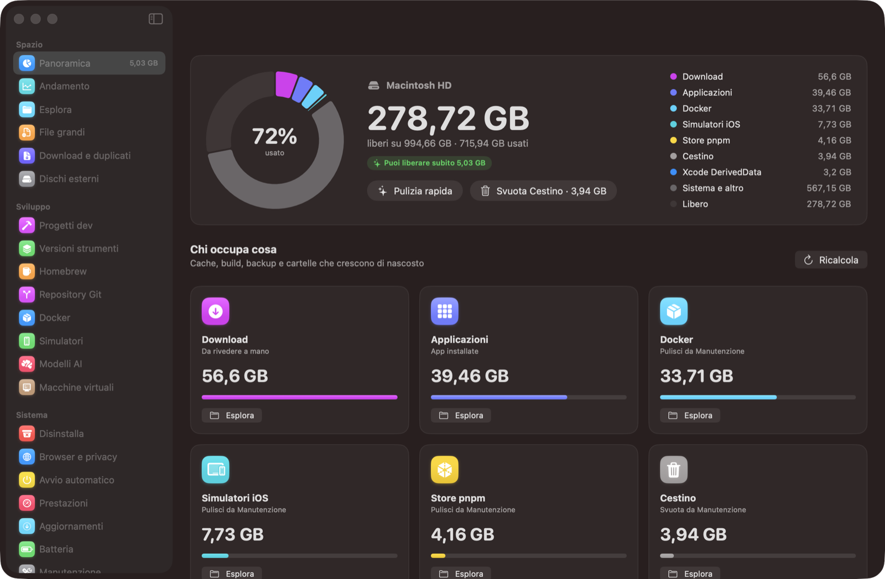

- App nativa **SwiftUI + Swift Charts**, macOS 15+, Apple Silicon
- **Nessuna dipendenza**, nessun progetto Xcode: si compila con `swiftc` da uno script
- Tutto quello che cancella va **nel Cestino** ed è ripristinabile dal Registro
- Scanner del disco proprio: **4-5× più veloce di `du`**, con cache per avere i dati subito all'apertura

---

## Funzioni

### Panoramica
L'anello del disco diviso per categoria e le card di "chi occupa cosa": cache, log, Xcode, simulatori, npm/pnpm/Gradle, Docker, backup iPhone, Download, app. Da qui partono **Pulizia rapida** e **Svuota Cestino**.

### Esplora e mappa a raggiera
Cartelle ordinate per peso, con la barra di composizione e le icone del Finder. Oppure la **mappa a raggiera**: tre anelli (cartella, sottocartelle, sotto-sottocartelle), nome e peso al passaggio del mouse, clic su una fetta per entrarci.

| Elenco | Mappa |
|---|---|
| 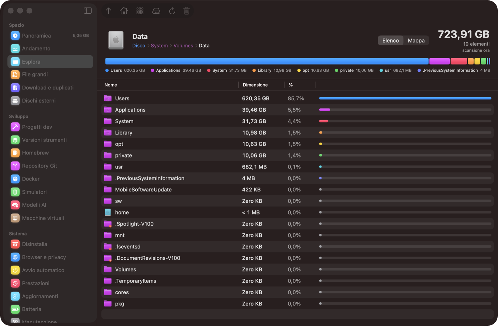 | 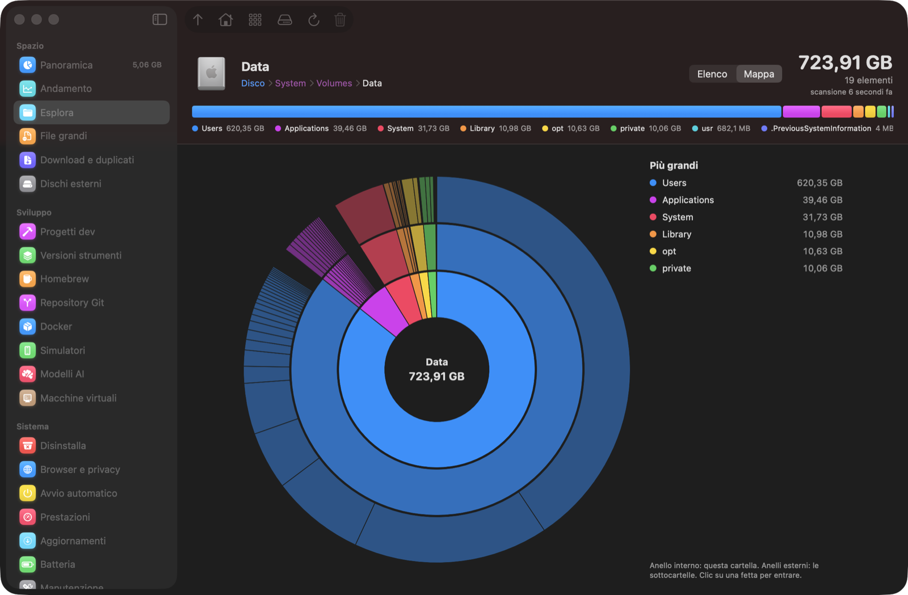 |

### Disinstalla
L'elenco delle app con peso, versione e ultimo uso. Per l'app selezionata trova i **residui in `~/Library`** (preferenze, cache, container, Application Support, stato finestre, LaunchAgent) con corrispondenze esatte sull'identificativo. Disinstalla tutto nel Cestino, chiudendo l'app se è aperta. Nell'esempio Docker pesa 2,3 GB, ma lascia 33,7 GB di container.

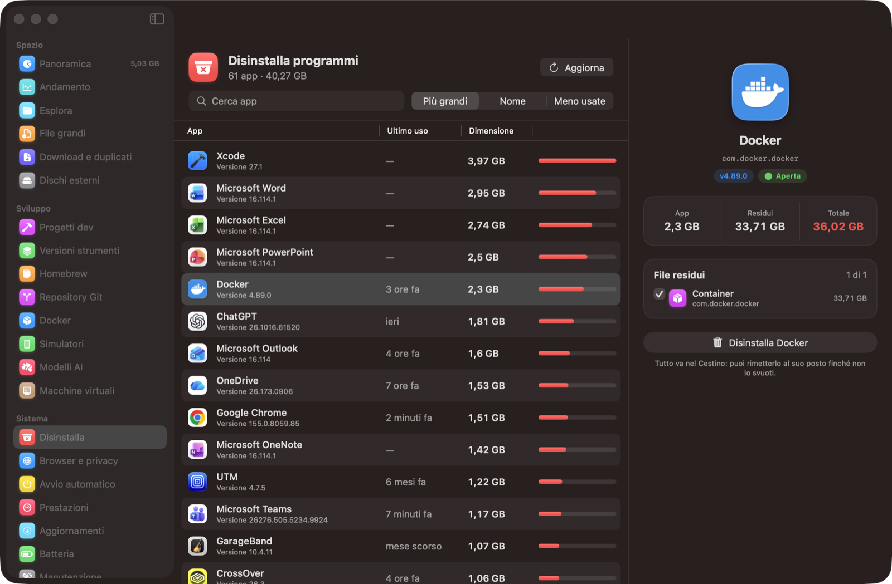

### Pulizia rapida, Svuota Cestino e festa
Un pannello con anteprima e spunte: cache, log, DerivedData, npm, Gradle, `brew cleanup`, simulatori non disponibili e Cestino. Le voci si spuntano man mano che finiscono. Alla fine compare lo spazio davvero liberato, con i coriandoli.

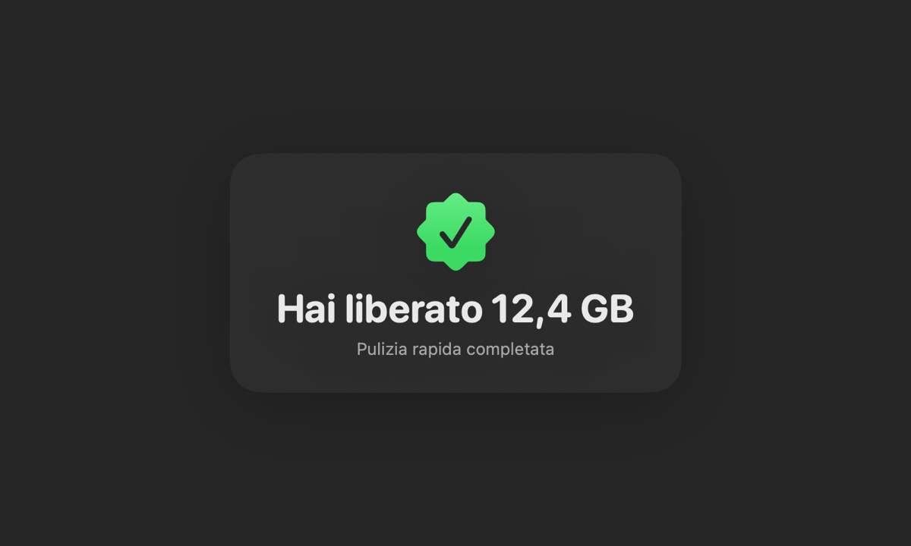

### Notch
Sui Mac con il notch, una breve sosta del mouse sul notch apre un pannello stile Dynamic Island con:
- spazio libero e RAM;
- i pulsanti Svuota Cestino, Pulizia rapida e Apri.

Quando è chiuso non si allarga mai ai lati, dove ci sono le icone della barra dei menu: i messaggi scendono sotto il notch e le scansioni sono una linea sottile.

| Pannello aperto | Dopo una pulizia |
|---|---|
| 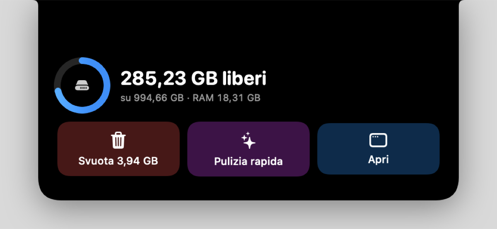 |  |

### Sviluppo
- **Progetti dev**: `node_modules`, `venv`, `target`, `Pods`, `.next`… in tutta la home.
- **Versioni strumenti**: Node (nvm), Python (pyenv), Ruby (rbenv), Rust (rustup), Java, Go, Gradle, Android. La versione in uso è protetta.
- **Homebrew**: pacchetti e app con peso, chi li usa e gli orfani.
- **Repository Git**: peso di `.git`, `git gc` e branch già unite (`git branch -d`, mai main/master/develop).
- **Docker**: immagini, container, volumi e build cache uno per uno.
- **Simulatori**: runtime e singoli simulatori di Xcode.
- **Modelli AI**: LM Studio, Hugging Face, Draw Things, Ollama.
- **Macchine virtuali**: UTM, Parallels, VMware, VirtualBox.

| Versioni strumenti | Homebrew |
|---|---|
| 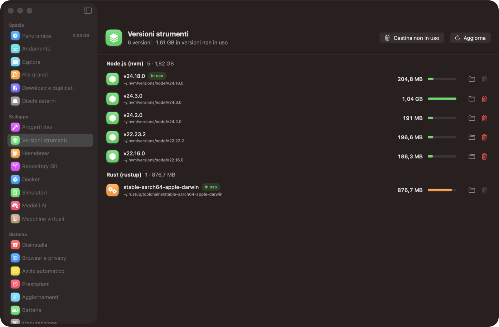 | 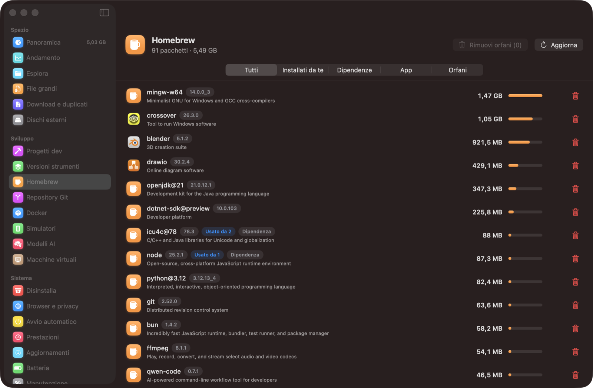 |

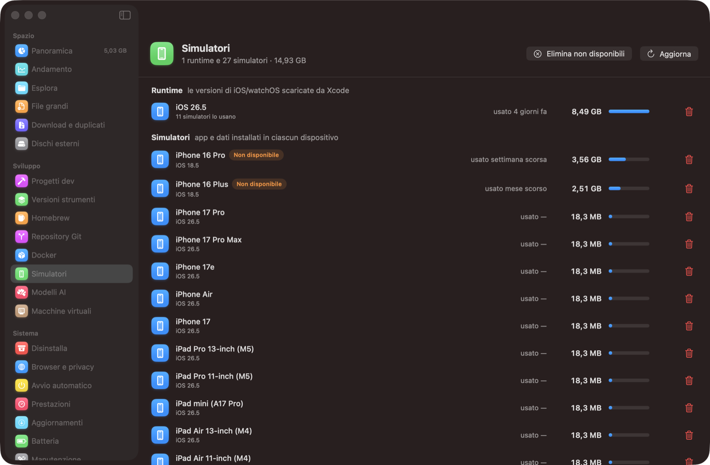

### Aggiornamenti
Gli **strumenti di sviluppo** (npm globali, pnpm, bun, Rust, uv, Claude Code, Node LTS), poi Homebrew, App Store (con `mas`) e macOS. Ognuno si aggiorna col suo comando, oppure c'è "Aggiorna tutto".

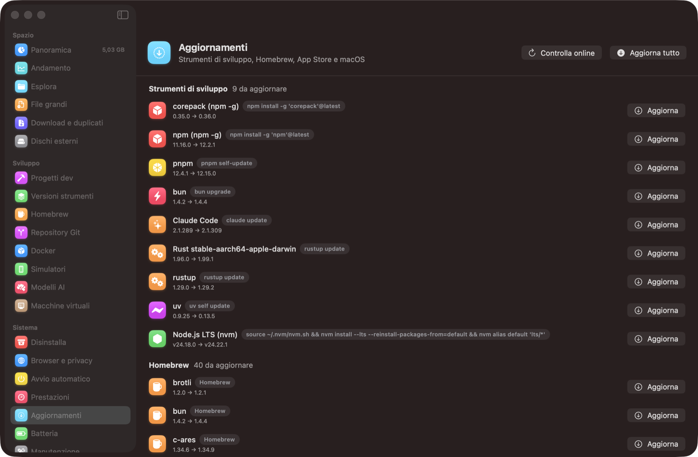

### Sistema
- **Browser e privacy**: cache, cronologia e cookie di Chrome, Edge, Brave, Arc, Safari e Firefox. Chiude il browser se è aperto; la cronologia di Firefox non si tocca, perché sta insieme ai segnalibri.
- **Avvio automatico**: LaunchAgent ed elementi di login. Si possono modificare solo gli agenti dell'utente; quelli di sistema o aziendali sono in sola lettura.
- **Prestazioni**: memoria (pressione e swap), CPU, app raggruppate con i loro processi, "Chiudi".
- **Batteria**: salute, cicli, capacità reale, temperatura, alimentatore.
- **Manutenzione**: comandi di pulizia dei tool, più la **pulizia programmata** (un LaunchAgent che lancia `MacSweep --autoclean` il giorno e all'ora scelti).
- **Registro**: tutto quello che è finito nel Cestino, raggruppato per sessione, con "Rimetti tutto".

| Browser e privacy | Batteria |
|---|---|
| 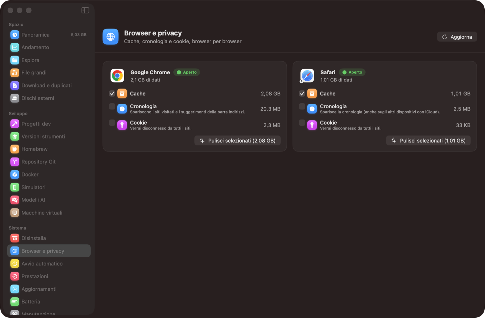 | 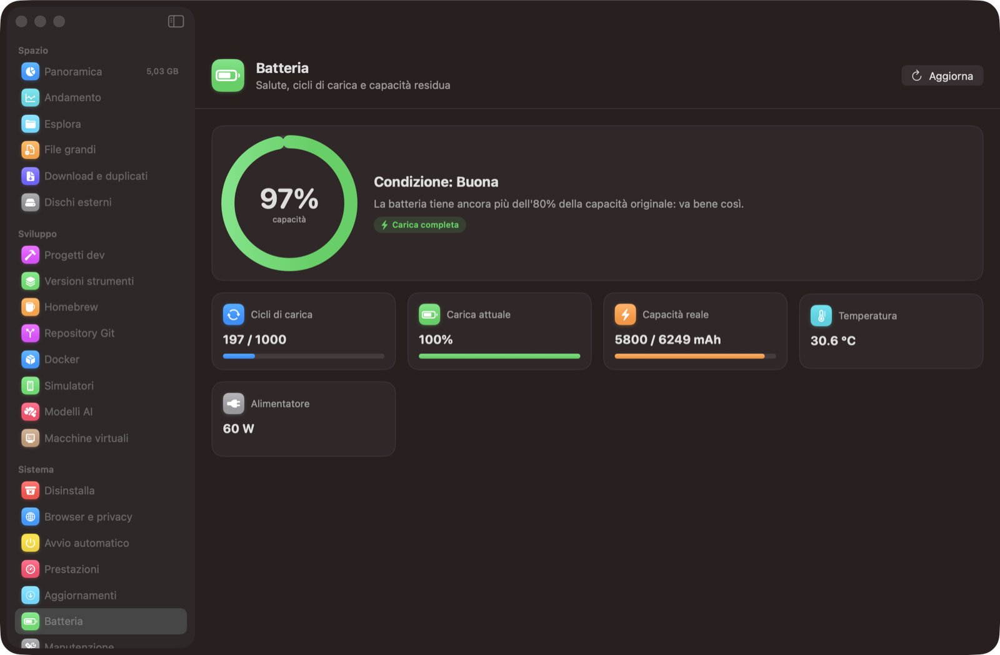 |

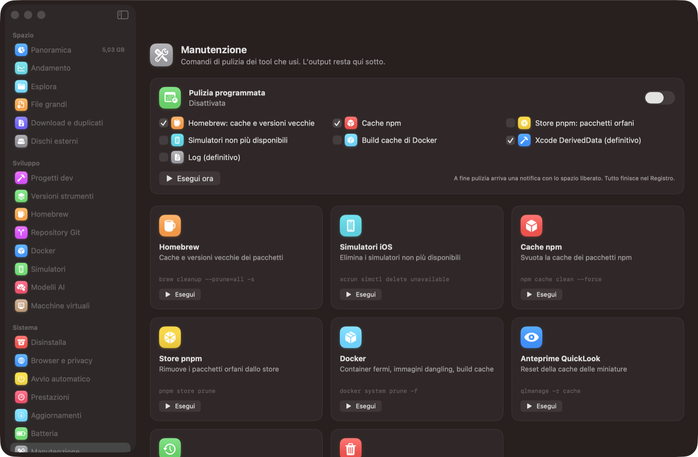

### Andamento e barra dei menu
Una fotografia del disco al giorno, il grafico dello spazio libero e "cosa è cresciuto" negli ultimi 7, 30 o 90 giorni. Nella barra dei menu ci sono lo spazio libero, un avviso sotto una soglia e le azioni rapide.

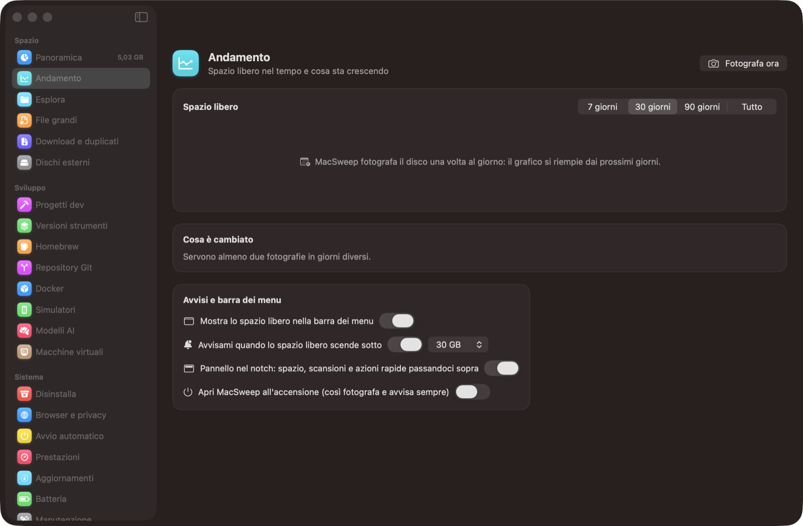

Tra le altre sezioni ci sono anche **File grandi** (con Spotlight), **Download e duplicati** (installer già usati, file mai aperti, duplicati veri riconosciuti col SHA-256) e **Dischi esterni** (file nascosti di macOS ed espulsione). ⌘R in ogni sezione ricalcola o cerca.

---

## Installazione

Servono macOS 15 o successivo e gli strumenti da riga di comando di Xcode (`xcode-select --install`).

```bash
git clone https://github.com/simiriva95/macsweep.git
cd macsweep
./build.sh install
```

`build.sh` compila con `swiftc`, genera l'icona, esegue il self-test e installa `/Applications/MacSweep.app`. Senza `install` crea solo `build/MacSweep.app`.

### Accesso completo al disco
Impostazioni di Sistema → Privacy e sicurezza → **Accesso completo al disco** → aggiungi MacSweep. Senza questo permesso, Cestino, Mail e alcuni container risultano vuoti.

Per verificare il permesso:

```bash
open -a MacSweep --args --diag && cat /tmp/macsweep-diag.txt
```

### Firma stabile (consigliata)
macOS lega l'Accesso completo al disco alla firma dell'app. Con la firma ad-hoc ogni ricompilazione fa perdere il permesso. Se nel portachiavi c'è un certificato di firma del codice chiamato **"MacSweep Local Signing"**, `build.sh` lo usa e il permesso resta. Per crearlo:

Accesso Portachiavi → Assistente Certificato → Crea un certificato → nome "MacSweep Local Signing", tipo identità "Radice autofirmata", tipo certificato "Firma del codice".

## Sicurezza

- File e cartelle vanno **nel Cestino** (`FileManager.trashItem`) e si ripristinano dal Registro.
- Le azioni definitive chiedono sempre una conferma esplicita: Svuota Cestino, le eliminazioni di Docker e dei simulatori (le fanno i rispettivi tool), e DerivedData/Log nella pulizia programmata se li spunti.
- Non tocca mai `/System`, `/Library`, le radici utente (`~`, `~/Library`, `~/Documents`…) né le cartelle dirette dentro `~/Library`. Fuori dalla home tocca solo `/Applications/*.app` e i dischi esterni.
- Ogni operazione finisce in `~/Library/Logs/MacSweep.log`.

## Struttura

| File | Contenuto |
|---|---|
| `Sources/App.swift` | ingresso, finestra, Panoramica, Esplora, Disinstalla, File grandi, Manutenzione |
| `Sources/Core.swift` | protezioni, Cestino, registro, stato dell'app |
| `Sources/Scanner.swift` | scanner parallelo (`getattrlistbulk`) e cache su disco |
| `Sources/Features.swift` / `FeatureViews.swift` | andamento, duplicati, Docker, simulatori, modelli AI, VM, avvio automatico, pulizia programmata, registro, barra dei menu |
| `Sources/More.swift` / `MoreViews.swift` | browser, prestazioni, aggiornamenti, versioni, Homebrew, Git, batteria, dischi esterni, mappa |
| `Sources/Extras.swift` | Svuota Cestino, Pulizia rapida, festa, updater sviluppo, notch |
| `scripts/icon.swift` | disegna l'icona |
| `build.sh` | build, firma, self-test, installazione |

Per verificare l'app senza interfaccia:
- `MacSweep --selftest`: protezioni, residui, scanner contro `du`, duplicati, ripristino, logica del notch;
- `MacSweep --render-map <cartella> <out.png>`: disegna la mappa di una cartella;
- `MacSweep --render-ui <cartella>`: disegna notch, festa e Pulizia rapida;
- `MacSweep --page <pagina>`: apre una pagina, comodo per gli screenshot.

## Licenza

[MIT](LICENSE)
